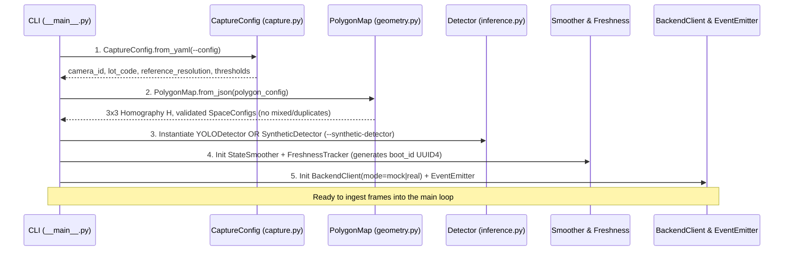

# Step 0 — Initialization, Dual Data Sources & Frame Ingestion

> **Status:** Foundation implemented in [`__main__.py`](../src/parking_occupancy/__main__.py) and [`capture.py`](../src/parking_occupancy/capture.py) | **Extensions planned:** Dual-profile camera tags (`cctv_oblique` vs. `optimized_angle`) and multi-camera session bootstrap  
> **Data Policy:** Dummy / synthetic sources only (`BACKEND_MODE=mock`)

---

## 1. Purpose

Before any perspective warping, contextual analysis, or AI inference occurs, the service must initialize safely, establish verifiable session metadata (`boot_id`, calibration identity, mock vs. gated real mode), and ingest frames uniformly from **two distinct camera data sources**:

1. **Data Type A — CCTV Stream / Image:** Existing campus CCTV feeds or angled upper-floor snapshots with significant perspective distortion, depth compression, and inter-row occlusion.
2. **Data Type B — Optimized-Angle Camera:** Cameras positioned at an ideal or near-overhead/clean angle (e.g., dedicated bay rig or tabletop synthetic rig) where bays are minimally occluded and distortion is low.

---

## 2. Step-by-Step Initialization Sequence

In [`src/parking_occupancy/__main__.py`](../src/parking_occupancy/__main__.py), startup follows a strict deterministic order so downstream modules never operate on unvalidated geometry or uninitialized state:



### Initialization Checklist

| Step | Component | Action & Validation | Failure Behavior |
|---|---|---|---|
| **0.1 CLI & Mode Selection** | `build_arg_parser()` | Explicitly select `--backend-mode mock\|real` and input source (`--still`, `--folder`, `--video`, or camera `source`) | Refuses `real` mode without configured `BACKEND_API_BASE_URL` |
| **0.2 Camera Profile Load** | `CaptureConfig.from_yaml()` | Loads `camera_id`, `lot_code`, `device_id`, `reference_resolution`, `smoothing_consecutive_frames`, `freshness_threshold_s`, `heartbeat_interval_s` | Raises YAML/KeyError on malformed config |
| **0.3 Geometry & Space Registry** | `PolygonMap.from_json()` | Validates 3×3 `homography_matrix`, rejects duplicate `space_id`, rejects `mixed` compatibility (`car_only \| motorcycle_only` only), validates Shapely polygon geometry (`>= 3` points, valid, `area >= 1.0`) | Raises `ValueError`; service refuses to start with broken map |
| **0.4 Detector Selection** | `YOLODetector` / `SyntheticDetector` | Loads CPU weights if `model_path` is provided; otherwise falls back to `SyntheticDetector` when `--synthetic-detector` or empty `model_path` | Raises `MissingWeightsError` if `model_path` points to a non-existent `.pt` file |
| **0.5 Temporal & Freshness State** | `StateSmoother`, `FreshnessTracker` | Initializes per-space buffers to `UNKNOWN`, generates fresh `boot_id` (UUIDv4), initializes `_last_frame_time` | Prevents premature `available` state before frames arrive |
| **0.6 Transport Setup** | `BackendClient`, `EventEmitter` | Generates client `boot_id`, initializes bounded `_retry_queue` (`maxlen=100`), binds `producer_id`, `model_version`, `calibration_version` | Mock mode logs locally; real mode remains gated/blocked |

---

## 3. Handling the Two Separate Data Types

To support both existing campus CCTV cameras and dedicated optimized-angle cameras within one codebase without duplicating logic, ingestion normalizes both into a single `Frame` dataclass while preserving camera profile metadata.

### Comparison of the Two Data Types

| Attribute | Data Type A: CCTV Feed / Image | Data Type B: Optimized-Angle Camera |
|---|---|---|
| **Vantage Point** | High building floor or corner pole, oblique angle ($30^\circ\text{–}60^\circ$) | Elevated centered / near-overhead or dedicated bay angle ($65^\circ\text{–}90^\circ$) |
| **Input Sources** | Campus CCTV RTSP snapshot, recorded `.mp4`, or reference `.jpg` stills | Local USB webcam, tabletop test rig, synthetic top-down renders, dedicated camera |
| **Perspective Distortion** | High — far rows compressed, lateral shear (like BSU View A/B/C) | Low to moderate — near-rectangular stall footprints |
| **Occlusion Risk** | High — front-row vehicles, trees, poles hide rear stalls | Low — clear view of stall ground boundaries |
| **Planned Profile Field (`camera_angle_type`)** | `cctv_oblique` | `optimized_angle` |
| **Downstream Trust Impact** | Wider confidence interval, stronger reliance on contextual occlusion & 1-min mean | Tighter confidence interval, direct area-ratio alignment |

### Planned Config Schema Extension (`configs/cameras/*.yaml`)

Currently, `CaptureConfig` parses `camera_id`, `source`, `reference_resolution`, `polygon_config`, `device_id`, `model_version`, `model_path`, and timing fields (plus an `extra: dict` bucket). For the two-source workflow, store camera-type metadata cleanly in YAML:

```yaml
camera_id: cam-lot-a-cctv-01
lot_code: A
device_id: occupancy-lot-a-01
reference_resolution: [1280, 960]
polygon_config: configs/polygons/dummy_cctv_lot_a.json
extra:
  camera_angle_type: cctv_oblique   # or "optimized_angle"
  detector_confidence_floor: 0.25   # lower gate for oblique CCTV proposals
  detector_trust_weight: 0.30       # supporting role in Cognitive Fusion Model
```

---

## 4. Uniform Frame Ingestion (`CameraCapture`)

[`CameraCapture`](../src/parking_occupancy/capture.py) abstracts all input sources into an iterator yielding immutable `Frame` objects:

```python
@dataclass(frozen=True)
class Frame:
    image: np.ndarray  # BGR, HxWx3
    timestamp: float   # monotonic seconds (supports fake-clock injection)
    camera_id: str
    frame_index: int
```

### Supported Ingestion Modes

1. **Single Still (`--still <path>`)**: Reads one image, enforces `reference_resolution`, yields 1 `Frame`. Ideal for calibration verification and unit/smoke tests.
2. **Evaluation Folder (`--folder <dir>`)**: Iterates sorted images in `SUPPORTED_IMAGE_EXTS` (`.jpg`, `.jpeg`, `.png`, `.bmp`, `.tiff`, `.webp`).
3. **Video Playback (`--video <path>`)**: Streams pre-recorded synthetic or tabletop test videos frame-by-frame.
4. **Live Stream / Webcam (`source` int or URL)**: Opens `cv2.VideoCapture`. Dropped frames terminate iteration or trigger `FreshnessTracker` staleness rather than guessing `available`.

### Resolution Normalization During Ingestion

Every ingested frame passes through `_resize_if_needed()`:
- Target size is `config.reference_resolution` (`[width, height]`).
- Ensures pixel coordinates always align with the calibrated homography matrix $H$ and `src_points` in `PolygonMap`.
- **Important guard:** If an external caller constructs a `Frame` directly at an unexpected resolution, `PolygonMap.classify()` rejects it and sets all spaces to `UNKNOWN` (`confidence: None`) so misaligned coordinates can never corrupt occupancy states.

---

## 5. Dummy Data Ingestion Strategy

During current independent development (while real campus streams and backend routes remain gated):
- Generate dummy blank, full, and partial scenes using [`tests/fixtures/generate_synthetic_frames.py`](../tests/fixtures/generate_synthetic_frames.py).
- Create separate dummy camera YAML pairs for:
  - `cctv_oblique` synthetic perspective test images (warped rectangles simulating angled cars).
  - `optimized_angle` synthetic top-down test images (clean top-down bay layout).
- Inject a deterministic `clock_fn` into `CameraCapture(..., clock_fn=...)` and `FreshnessTracker(..., clock_fn=...)` so 1-minute rolling confidence windows and 30-second stale timeouts can be tested instantaneously without waiting real wall-clock minutes.

---

## 6. Refreshness & Re-Initialization Triggers

A running service does not only initialize once at startup; it must re-sync safely when conditions change:

1. **Camera Reconnect (`FreshnessTracker.reconnect()`)**:
   - Generates a brand-new `boot_id`.
   - Clears per-space sequence numbers back to `0`.
   - Clears `_is_stale` only once genuinely new frames (advancing `frame_timestamp`) arrive.
2. **Smoothing Reset (`StateSmoother.reset_space()`)**:
   - Clears rolling transition counters after reconnect or recalibration so stale buffers do not carry over into a new session.
3. **Calibration Version / Resolution Change**:
   - Any mismatch between frame resolution and `reference_resolution` or between active `calibration_version` and expected config immediately marks covered spaces `unknown` until re-initialized with valid calibration JSON.

