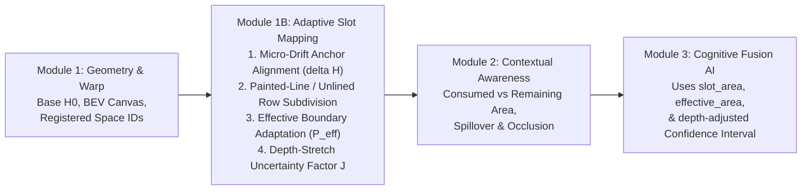

# Module 1B — Adaptive Mapping of Slots

> **Status:** **Target New Module** (planned `src/parking_occupancy/adaptive_mapping.py`, extending `geometry.py` and feeding `contextual.py` & `fusion_model.py`)  
> **Data Policy:** Developed and tested strictly on **dummy data** (synthetic BEV row zones, simulated camera micro-drift fixtures, and synthetic unlined concrete pads)  
> **SENTRY Authority Guardrail:** Adapts spatial polygon boundaries for **already-registered** slots only (`car_only | motorcycle_only`); never invents unregistered `space_id`s, never creates `mixed` slots, and never alters backend allocations

---

## 1. Why Adaptive Slot Mapping Is Needed

Static polygons assume that once calibrated, a camera never vibrates, painted stall lines are always crisp, every vehicle parks neatly inside fixed lines, and pixel precision is identical near and far from the lens. In real campus lots—especially across **two camera data types** (`cctv_oblique` vs. `optimized_angle`)—those assumptions break down:

1. **Micro-Drift & Mount Vibration (CCTV Feeds):** Wind load, thermal expansion, or slight bracket sag shifts an oblique CCTV frame by 3–10 pixels. On far rows, a 5-pixel camera shift can push vehicle footprints across adjacent static slot lines.
2. **Unlined or Faded Concrete Pads:** Portions of campus parking areas (such as concrete slabs in oblique Views A/C) lack crisp painted lane dividers, causing drivers to park with slightly shifted spacing along a row.
3. **Oversized or Off-Center Vehicles Reshaping Adjacent Space:** When one parked vehicle shifts left or spans across a loose gap, fixed boxes fail to reflect where the *next* car can physically fit.
4. **Depth-Varying Resolution Across CCTV vs. Optimized Angle:** Far bays in `cctv_oblique` suffer severe BEV stretch (lower spatial precision per meter), whereas `optimized_angle` cameras see uniform ground pixels.

**Module 1B (Adaptive Slot Mapping)** sits directly after **Geometry & Perspective Warping** so slot geometry dynamically accounts for small camera drift, faint/unlined zones, neighbor boundary shifts, and per-slot perspective stretch before **Contextual Awareness** computes consumed vs. remaining area.

---

## 2. Where It Fits in the Pipeline

---

## 3. Core Adaptive Mapping Methods

### Method 1 — Anchor-Guided Micro-Drift Compensation ($\Delta H$)

To keep mapped slots locked onto real pavement despite minor CCTV vibration or slight angle drift without throwing away valid calibration:

1. **Static Anchor Patches (`ground_anchors`):**
   - Calibration JSON stores 4+ vehicle-free ground landmarks (curb corners, drain grates, building base edges, fixed bollards, painted crosswalk tips) outside parking bays.
2. **Alignment Estimation:**
   - Periodically (e.g., every $N$ frames or on static background check), align current anchor patches against calibration reference patches via sparse feature matching (`ORB` + RANSAC) or intensity alignment (`cv2.findTransformECC`) constrained to planar homography $\Delta H$.
   - Compute effective homography:
     $$H_{\text{eff}} = \Delta H \cdot H_0$$
3. **Hard Drift Safety Threshold ($\tau_{\text{drift}}$):**
   - Measure mean landmark reprojection shift $d_{\text{drift}}$ in BEV pixels:
     - **Normal ($d_{\text{drift}} \le 2\text{ px}$):** Keep $H_0$ unchanged (zero unnecessary jitter).
     - **Adaptive Recovery ($2\text{ px} < d_{\text{drift}} \le \tau_{\text{drift}}$, e.g. $10\text{ px}$):** Smoothly apply $H_{\text{eff}}$ after temporal consensus (30–60s steady drift confirmation) and record an `adaptive_drift_offset` diagnostic flag.
     - **Moved Camera Fault ($d_{\text{drift}} > \tau_{\text{drift}}$):** Refuse auto-adaptation! Camera mount moved beyond safe bounds → immediately mark all covered slots `UNKNOWN` (`confidence: null`) and require explicit recalibration via `scripts/mark_polygons.py`.

---

### Method 2 — Row-Corridor Auto-Partitioning & Paint-Line Snapping

Manually drawing 25 adjacent polygons pixel-by-pixel is error-prone and breaks easily in unlined zones. Adaptive Mapping supports **Row Zone → Slot Subdivision**:

1. **Parent Row Corridor Definition:**
   - Config specifies a calibrated BEV **row corridor quadrilateral**, its ordered list of **pre-registered** backend slots (`[space_id_1, ..., space_id_K]`), `compatibility` (`car_only` or `motorcycle_only`), and row orientation vector $\vec{u}$.
2. **Paint-Stripe Refinement (When Markings Exist):**
   - Warp the row corridor to BEV (`warp_to_bev()`).
   - Apply Sobel edge projection / adaptive threshold along axis $\vec{u}$ (averaging across the **1-minute window** or empty-pavement baseline so parked vehicle shadows don't create false lines).
   - Snap internal divider coordinates $(s_1, \dots, s_{K-1})$ to strong painted line peaks near expected metric bay widths.
3. **Uniform Metric Fallback (When Lines Are Faded or Absent):**
   - Where pavement markings are absent/occluded, partition the corridor length $L_{\text{row}}$ into $K$ equal metric bay slots (with compatibility-specific minimum widths: e.g., `car_only` bay width $\approx 2.4\text{–}2.6\text{ m}$, `motorcycle_only` bay width $\approx 1.0\text{–}1.2\text{ m}$).

---

### Method 3 — Occupancy-Guided Effective Boundary Adaptation ($P_{\text{base}, i} \rightarrow P_{\text{eff}, i}$)

Every registered slot maintains two distinct geometries per frame:
- **Baseline Registered Polygon ($P_{\text{base}, i}$):** The static reference bay boundary from calibration / row partitioning (used for stable `space_id` ownership and calibrated `slot_area`).
- **Effective Usable Polygon ($P_{\text{eff}, i}$):** The adapted physical footprint currently usable inside/around that slot after accounting for neighboring vehicles!

Adaptive boundary behavior follows **one of two configured row policies**:

| Policy Mode | Applicable Zones | How Slot Boundaries Adapt |
|---|---|---|
| **`strict_stalls`** *(Painted bays)* | Marked car & motorcycle stalls | Slot center stays fixed on painted lines, **but** any encroachment from a neighboring vehicle shrinks $P_{\text{eff}, i} = P_{\text{base}, i} \setminus P_{\text{neighbor}}$ and computes `usable_width`. If remaining $P_{\text{eff}, i}$ fails minimum vehicle dimensions, Contextual Awareness flags `spillover_blocked` (`occupied`). |
| **`adaptive_curb`** *(Unlined concrete rows)* | Unpainted concrete pads with registered capacity $K$ | Along an unlined row of length $L_{\text{row}}$, detected parked vehicles partition the free pavement intervals dynamically into remaining contiguous segments of size $\ge W_{\text{min\_vehicle}}$. Registered slots map deterministically left-to-right (or anchor-to-end): occupied bays match physical vehicle footprints, and remaining contiguous open span computes how many compatible slots remain genuinely open (`available`) vs. fragmented unusable gaps! |

*Why two modes?* Shifting slot boundaries freely inside a **painted** lot would mismatch painted bay numbers visible to students/guards on campus; keeping `strict_stalls` preserves slot number truth (`A-C01`, `A-C02`), while `adaptive_curb` solves unlined concrete strips where drivers naturally shift a few decimeters!

---

### Method 4 — Perspective-Depth Scale & Margin Adaptation (CCTV vs. Optimized)

In `cctv_oblique` footage, a 1-pixel bounding-box error in a **far row** corresponds to a much larger distance on the pavement (e.g., $15\text{ cm/px}$) than in a **near row** ($2\text{ cm/px}$), whereas `optimized_angle` footage has near-constant ground scale.

Adaptive Mapping computes a per-slot **Local Homography Distortion Factor ($J_i$)** at slot $i$'s BEV center $(x'_i, y'_i)$ via the local Jacobian of $H^{-1}$:
1. Project small BEV perturbations $(x'_i \pm \Delta, y'_i \pm \Delta)$ back to raw image coordinates via $H^{-1}$.
2. Compute raw image pixel area per unit BEV area: lower raw pixel density $\rightarrow$ **higher $J_i$**.
3. **Adaptive Effects:**
   - Slightly widens geometric boundary hysteresis / matching padding on high-$J_i$ far CCTV slots so marginal alignment jitter does not flicker states.
   - Feeds $J_i$ directly into **Module 3 (Cognitive Fusion Model)** to scale $\delta_{\text{angle}}$ in the slot's **`confidence_interval`** (`[ci_low, ci_high]`)—automatically expressing wider uncertainty on stretched far-row CCTV slots and tight confidence intervals on `optimized_angle` slots!

---

## 4. Temporal Safety & Anti-Thrashing Rules

1. **No Reactive Frame-by-Frame Map Thrashing:**
   - Drift updates ($\Delta H$) and painted-line snapping update only on a slow stability cadence (e.g., smoothed over the **1-minute window** or background verification), never snapping onto moving cars or pedestrians.
2. **SENTRY Invariants Preserved:**
   - Adaptive Slot Mapping **never** creates new `space_id`s beyond the configured registry, **never** changes `lot_code`, and **never** alters `car_only | motorcycle_only` compatibility.
   - Outbound `occupancy_observation` events continue reporting the canonical registered `space_id` and `calibration_version` (logging any `drift_adapted` offset internally for diagnostics).
   - If anchor tracking loses sight anchors (fog, dark night without lighting, obstruction) or drift exceeds $\tau_{\text{drift}}$, fallback is strictly **`UNKNOWN`** (`confidence: null`) — never `AVAILABLE`.

---

## 5. Development Plan & Dummy Data Tests

Built into planned `src/parking_occupancy/adaptive_mapping.py` and tested with synthetic dummy scenarios (`tests/unit/test_adaptive_mapping.py`):

| Dummy Test Scenario | Simulation Input | Expected Adaptive Output |
|---|---|---|
| **1. Micro-Drift Recovery (Dummy CCTV)** | Synthetic BEV frame warped with $+5\text{ px}$ translation & $1^\circ$ rotation keeping dummy static corner anchors intact | $\Delta H$ recovers ground alignment within $< 1\text{ px}$ error; slots stay locked onto dummy vehicles |
| **2. Moved Camera Rejection** | Synthetic frame shifted by $+40\text{ px}$ ($> \tau_{\text{drift}}$) | Auto-adaptation refused; all covered spaces transition to `UNKNOWN` (`confidence: null`) |
| **3. Unlined Row Partitioning (`adaptive_curb`)** | Synthetic blank concrete strip (`400×100 px`, `K=4` registered `car_only` IDs) with 2 poorly spaced dummy car boxes leaving fragmented gaps | Adaptive mapper computes remaining contiguous open intervals and prevents double-counting fragmented unparkable half-gaps |
| **4. Painted Stall Spillover (`strict_stalls`)** | Dummy car in `A-C01` encroaching 30% into `A-C02` | `P_eff` for `A-C02` shrinks below `min_usable_width`; passed cleanly to `contextual.py` as `spillover_blocked` |
| **5. Far vs. Near Depth Scale ($J_i$)** | Dummy oblique homography with near row at bottom and far row near top | Far row receives higher $J_i$ distortion metric and passes wider uncertainty factor to Fusion Model CI |

