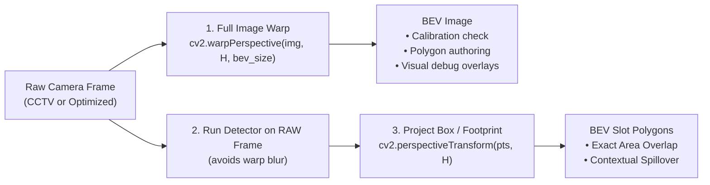

# Module 1 — Geometry, Image Reshaping & Two-Source Perspective Warping

> **Status:** Core homography warp & point projection implemented in [`geometry.py`](../src/parking_occupancy/geometry.py) and [`mark_polygons.py`](../scripts/mark_polygons.py) | **Extensions planned:** Ground-plane foot-point projection, full bbox footprint polygon warping, and dual-profile calibration presets (`cctv_oblique` vs. `optimized_angle`)  
> **Data Policy:** Dummy / synthetic reference layouts and synthetic UUIDs (`30000000-...`) used for development

---

## 1. Why Geometry & Reshaping Come First

A parking camera rarely looks straight down at the ground like a map. Depending on the hardware deployment, SENTRY handles **two separate types of visual data**:

1. **CCTV Data (Oblique / Elevated Campus Views):**
   - Mounted high on buildings or poles looking across the lot at $30^\circ\text{–}60^\circ$.
   - Introduces severe **perspective foreshortening**: a parking bay near the bottom of the frame might occupy $180 \times 120$ px, while an identical bay in the far row occupies only $45 \times 25$ px.
   - Vehicle roofs appear shifted *upward* in pixel space relative to where their tires actually touch the pavement.
2. **Optimized-Angle Camera Data (Clean Overhead / High-Depression Rig):**
   - Positioned closer to overhead or square-on to a smaller bay cluster (e.g., dedicated bay camera or tabletop test setup).
   - Minimal perspective skew, uniform pixel-to-meter scale, minimal cross-slot roof overhang.

**Goal of Module 1:** Reshape and mathematically project **both** camera types onto a unified, metric-consistent **Bird's-Eye View (BEV)** 2D plane so that every parking slot has a well-defined rectangular/polygonal area and downstream modules (Contextual Awareness & Cognitive Fusion AI) can measure area ratios identically across both data types.

---

## 2. Geometry & Warping Methods

### Method A — Image Reshaping & Pre-Warp Conditioning

Before applying perspective homography, incoming frames undergo standardized reshaping:

1. **Resolution Standardization (`_resize_if_needed`)**:
   - Resize incoming frames `(W_raw, H_raw)` to calibrated `reference_resolution` `(W_ref, H_ref)` (e.g., `[1280, 960]` or `[640, 480]` for dummy fixtures) using `cv2.resize(..., interpolation=cv2.INTER_LINEAR)`.
   - *Why:* A homography matrix $H$ is strictly valid only for the pixel coordinate grid `(W_ref, H_ref)` on which `src_points` were clicked.
2. **Optional Lens Undistortion (Planned for Wide-Angle CCTV / Fisheye)**:
   - If a CCTV lens exhibits barrel distortion (curved painted lines near frame edges), apply `cv2.undistort(frame, K, dist_coeffs)` *before* homography estimation so straight lot lines become mathematically straight in image space.
   - Store optional `camera_matrix` ($K$) and `dist_coeffs` in the camera profile JSON.
3. **Aspect-Ratio & ROI Cropping Guard**:
   - Never stretch a `16:9` CCTV feed arbitrarily into `4:3` without updating `reference_resolution` and recalibrating $H$; otherwise angular ratios break. If aspect ratios differ, letterbox/pad or crop deterministically during ingestion.

---

### Method B — Homography Matrix Estimation ($H$)

A planar **homography** is a $3 \times 3$ projective transformation matrix $H$ with 8 degrees of freedom mapping ground-plane pixels $(x, y)$ in the original image to flat top-down BEV coordinates $(x', y')$:

$$
\begin{bmatrix} x'_{\text{h}} \\ y'_{\text{h}} \\ w' \end{bmatrix}
=
\begin{bmatrix}
h_{00} & h_{01} & h_{02} \\
h_{10} & h_{11} & h_{12} \\
h_{20} & h_{21} & h_{22}
\end{bmatrix}
\begin{bmatrix} x \\ y \\ 1 \end{bmatrix},
\qquad
x' = \frac{x'_{\text{h}}}{w'}, \quad y' = \frac{y'_{\text{h}}}{w'}
$$

#### Estimation Procedure (`scripts/mark_polygons.py`)
1. Pick $N \ge 4$ non-collinear **ground-plane anchor points** `src_points` on the raw reference image (e.g., painted stall corners, concrete slab edges, curb corners—**never** points on trees, roofs, or car tops, because homography only holds on $Z = 0$ ground plane!).
2. Define matching real-world scaled points `dst_points` on the flat BEV canvas `(bev_w, bev_h)`, e.g., using a uniform scale such as `1 px = 5 cm` (`20 px/m`), so a standard $2.5\text{ m} \times 5.0\text{ m}$ car slot becomes $50 \times 100$ px in BEV regardless of camera type.
3. Compute $H$ with RANSAC outlier rejection:
   ```python
   H, mask = cv2.findHomography(src_pts, dst_pts, cv2.RANSAC, 5.0)
   ```
4. Visually validate the warped image: painted lane lines must appear parallel and slot widths uniform.

#### Anchor Selection Differences: CCTV vs. Optimized Angle

| Step | Data Type A: CCTV (Oblique) | Data Type B: Optimized Angle |
|---|---|---|
| **Minimum Anchor Points** | 6–8 spread across near, mid, and far rows to stabilize far-row projection error | 4 corners of the bay perimeter or calibration grid |
| **Ground-Plane Rule** | Pick painted stall corners / concrete joints strictly at ground height ($Z=0$) | Pick bay corners or tabletop mat corners |
| **BEV Canvas Scale** | Larger canvas (e.g. `800×600`) so distant rows retain sufficient pixel area | Compact canvas (e.g. `600×500` or `400×300`) matching bay grid |
| **Sensitivity to Shift** | Very high — a $2^\circ$ wind/mount tilt shifts far rows by entire slots | Moderate — easy to detect via fixed reference marker |

---

### Method C — Dual-Domain Projection (How Images & Boxes Are Warped)

We use **both** image warping and geometric coordinate projection—each for what it does best:



1. **Full Image Warp (`PolygonMap.warp_to_bev`)**:
   - Uses `cv2.warpPerspective(image, self.homography_matrix, (bev_w, bev_h), flags=cv2.INTER_LINEAR)`.
   - Used for interactive polygon marking (`mark_polygons.py`), debugging BEV previews, generating synthetic warped test views, and (optionally) lightweight pixel/edge change checks inside a known slot mask.
2. **Coordinate Projection (`PolygonMap.project_point_to_bev` & `project_detections_to_bev`)**:
   - **Why detect on the raw image?** Warping oblique CCTV frames stretches distant pixels and smears vehicle edges, hurting detector recall. Running detection on the raw image and transforming coordinates via `cv2.perspectiveTransform` preserves native visual fidelity.
   - **Current implementation (`geometry.py`):** Projects each detection's bounding-box center `(cx, cy)` through $H$.
   - **Planned upgrade for CCTV Oblique Accuracy (Footprint Projection):**
     - Because tall vehicles (vans/SUVs) viewed from an oblique CCTV angle have a bounding-box center elevated above the ground plane ($Z > 0$), projecting `(cx, cy)` can land *behind* the true slot into the next row!
     - **Solution:** Project the **ground-contact region** (the bottom edge / lower $30\%\text{–}40\%$ quadrilateral of the bounding box: `(x1, y_mid_low), (x2, y_mid_low), (x2, y2), (x1, y2)`) through $H$ into BEV space to create a **projected vehicle footprint polygon** $P_{\text{vehicle}}$!
     - For **Optimized-Angle (`optimized_angle`)** data, the full bounding box `(x1, y1)..(x2, y2)` is nearly planar on the ground and can be projected directly (or with minimal bottom-bias).

3. **Inverse Projection ($H^{-1}$) for Visual Occlusion Analysis**:
   - To check whether a foreground vehicle blocks the camera's line-of-sight to a rear slot (used in Module 2: Contextual Awareness), we can invert $H$ (`np.linalg.inv(H)`) to project BEV slot polygons back into the raw CCTV camera plane where 2D occlusion height occurs!

---

## 3. Slot Representation & Geometric Validation

Each parking space in BEV coordinates is represented by `SpaceConfig` (in `geometry.py`):
- `space_id`: Canonical UUID (synthetic `30000000-0000-4000-8000-...` in dummy/mock configs) + human-readable `slot_number` (e.g., `A-C01`) for Fusion Model reporting.
- `lot_code`: `A | B | C | D`.
- `compatibility`: Strictly `car_only | motorcycle_only` (never `mixed`).
- `polygon_bev`: Ordered list of vertices in BEV pixel space, backed by `ShapelyPolygon`.
- `area_px`: Precomputed ground-plane area in $\text{px}^2$ (`self._shapely.area`).

### Mandatory Validation Rules (`PolygonMap.from_json` & `validate_polygon`)
- Reject duplicate `space_id` entries.
- Reject `compatibility` values outside `car_only | motorcycle_only` (e.g., legacy `mixed`).
- Reject polygons with `< 3` vertices, out-of-canvas vertices, self-intersections (`not poly.is_valid`), or degenerate tiny area (`< 50 px²` in authoring tool / `< 1 px²` on load).
- Reject frame resolution mismatches (`frame.resolution != reference_resolution`) → immediately output `UNKNOWN` for all spaces.

---

## 4. How the Geometry Module Will Be Developed (Step-by-Step)

| Dev Step | Deliverable | Details & Verification |
|---|---|---|
| **G1. Calibration Presets (Dummy Dual Sources)** | `configs/cameras/dummy_cctv.yaml`, `configs/cameras/dummy_optimized.yaml`, plus matching `configs/polygons/*.json` | Create two synthetic datasets: (a) skewed trapezoid dummy lot rendered via inverse warp to simulate CCTV oblique view; (b) clean top-down grid simulating optimized angle. |
| **G2. Interactive & Scripted Calibration** | Enhanced `scripts/mark_polygons.py` | Support side-by-side raw + BEV overlay preview, reprojection error readout (RMSE in BEV px), auto-export of `slot_number` and `slot_area_px`. |
| **G3. Footprint Polygon Projection** | `project_detection_footprint(det, camera_angle_type)` in `geometry.py` | Project bottom-portion quad for `cctv_oblique` vs. full bbox quad for `optimized_angle` through $H$ into Shapely polygons in BEV space. |
| **G4. Inverse Projection & Sightline Helper** | `project_bev_poly_to_image(poly_bev)` using $H^{-1}$ | Enables Contextual Awareness to test line-of-sight blocking in native camera coordinates for CCTV views. |
| **G5. Geometry Unit Tests** | Expanded `tests/unit/test_geometry.py` | Test non-identity homographies (synthetic oblique $\leftrightarrow$ BEV), area preservation across near/far slots, footprint projection accuracy, and resolution-mismatch fail-safe. |

---

## 5. Geometry Output Passed Downstream

For every frame and every calibrated slot, Geometry provides:
1. `bev_image` (optional/debug warped frame), active `calibration_version` + `camera_angle_type`, and baseline homography $H_0$.
2. Each slot's `slot_number` / `space_id`, `compatibility`, baseline `polygon_bev`, and calibrated `slot_area` ($\text{px}^2$).
3. Projected vehicle polygons $P_{\text{vehicle}, k}$ in BEV space (passed into [Module 1B: Adaptive Mapping of Slots](02B_ADAPTIVE_SLOT_MAPPING.md) for micro-drift alignment, unlined-row partitioning, effective usable polygons $P_{\text{eff}}$, and depth-stretch computation before entering **Module 2: Contextual Awareness**).
