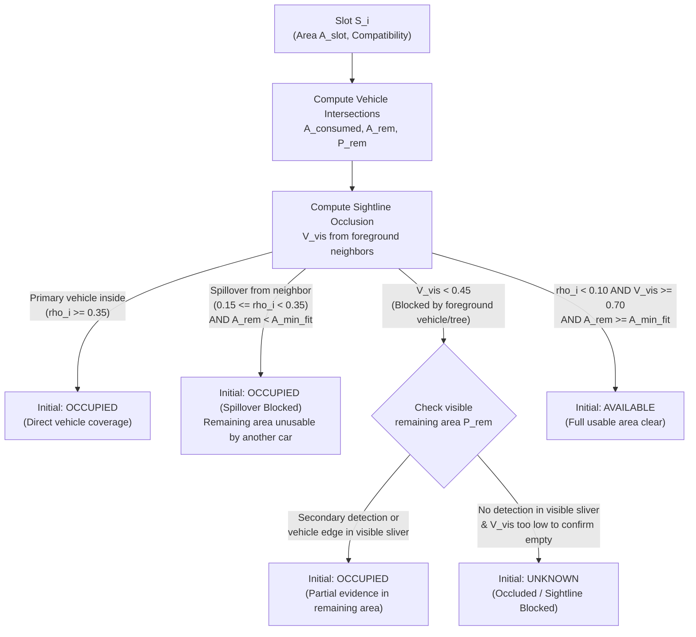

# Module 2 — Contextual Awareness & Cross-Slot Intelligence

> **Status:** **Target New Module** (planned `src/parking_occupancy/contextual.py`, building on `geometry.py` and `inference.py`)  
> **Data Policy:** Developed and verified 100% with **dummy data** (synthetic BEV slot layouts, simulated vehicles, dummy adjacency graphs, and synthetic occlusion test cases)

---

## 1. Why Contextual Awareness Is Necessary

Basic occupancy detectors evaluate each slot in isolation: *"Is there a detection centroid inside Polygon $i$?"*  
In real parking lots—especially angled CCTV views—evaluating slots in isolation fails repeatedly:

1. **Area Spillover / Straddling:** A large van or badly parked car in Slot 1 spills over into Slot 2. Slot 2's centroid test sees *no* vehicle center inside Slot 2, so a naive detector says Slot 2 is `available`—even though **no car can fit in the remaining area**!
2. **Line-of-Sight Blocking (Occlusion):** In an oblique CCTV feed, a tall vehicle parked in foreground Slot 1 visually hides Slot 4 directly behind it. Absence of a detection in Slot 4 does **not** mean Slot 4 is empty.
3. **Partial Visibility / Secondary Vehicle Detection:** Conversely, if a foreground vehicle only partially overlaps a neighboring slot, the **remaining unobstructed area** must be inspected carefully to recognize whether *another* vehicle is occupying that remaining region or if that slot is genuinely open or blocked.

**Module 2 (Contextual Awareness)** solves this by shifting from **per-slot independent point checks** to **lot-wide spatial & area-conservation reasoning**.

---

## 2. Core Spatial Concepts & Definitions

For every slot $S_i$ in BEV space (having baseline polygon $P_{\text{base}, i}$, **adaptively adjusted effective polygon** $P_{\text{eff}, i}$ from [Module 1B: Adaptive Slot Mapping](02B_ADAPTIVE_SLOT_MAPPING.md), and calibrated area $A_{\text{slot}, i}$):

### A. Vehicle Area Consumption ($A_{\text{consumed}, i}$)
Given all projected vehicle footprint polygons $\{P_{\text{vehicle}, k}\}$ in BEV space:
1. Compute the geometric intersection area inside slot $i$:
   $$A_{\text{overlap}}(k, i) = \text{Area}\big(P_{\text{vehicle}, k} \cap P_{\text{slot}, i}\big)$$
2. Compute the union of all overlapping vehicle footprints within slot $i$:
   $$A_{\text{consumed}, i} = \text{Area}\left(P_{\text{slot}, i} \cap \bigcup_{k} P_{\text{vehicle}, k}\right)$$
3. Compute the **Occupied Area Fraction**:
   $$\rho_i = \frac{A_{\text{consumed}, i}}{A_{\text{slot}, i}} \in [0.0, 1.0]$$

### B. Remaining Free Area ($A_{\text{rem}, i}$)
$$A_{\text{rem}, i} = A_{\text{slot}, i} - A_{\text{consumed}, i}$$
Beyond raw pixel count, Contextual Awareness checks **contiguous usable remaining area**:
- Compute the geometric difference polygon: $P_{\text{rem}, i} = P_{\text{slot}, i} \setminus \bigcup_k P_{\text{vehicle}, k}$.
- Compare the largest contiguous sub-polygon of $P_{\text{rem}, i}$ (and its minimum inscribed width/length) against the minimum physical footprint $A_{\text{min\_fit}}(\text{compatibility}_i)$ required for a `car_only` or `motorcycle_only` vehicle.

### C. Visibility & Occlusion Ratio ($V_{\text{vis}, i}$)
Using the camera's known vantage direction in BEV (and/or inverse projection $H^{-1}$ to the raw camera plane):
- When a foreground slot $S_j$ (closer to camera along the sightline) is occupied by vehicle $V_k$, project an **occlusion shadow polygon** $P_{\text{shadow}, k}$ outward along the radial ray from camera position across rear slots.
- Compute the occluded area of slot $i$:
  $$A_{\text{occluded}, i} = \text{Area}\big(P_{\text{slot}, i} \cap \bigcup_{k} P_{\text{shadow}, k}\big)$$
- **Visible Area Ratio:**
  $$V_{\text{vis}, i} = 1.0 - \frac{A_{\text{occluded}, i}}{A_{\text{slot}, i}}$$

---

## 3. Contextual Intelligence Scenarios & Decision Rules



### Detailed Walkthrough of Key Contextual Cases

#### Case 1: Single Vehicle Filling Slot $i$ + Affecting Neighbor Slot $i+1$ (Spillover)
- **Observation:** Vehicle $V_1$ sits mostly in Slot 1 ($\rho_1 = 0.72$), with $28\%$ of its bumper/side crossing the boundary into Slot 2 ($\rho_2 = 0.25$).
- **Contextual Reasoning:**
  - Slot 1 is directly `occupied`.
  - For Slot 2: remaining area $A_{\text{rem}, 2} = 75\% \times A_{\text{slot}, 2}$, **but** its remaining usable width is narrower than a standard car width ($W_{\text{rem}} < W_{\text{min\_car}}$).
  - Therefore, Slot 2 is flagged `spillover_blocked` → `initial_recognition = occupied` (with contextual evidence note `affected_by=slot_1`), preventing SENTRY from directing an incoming driver into an unusable half-slot!

#### Case 2: Foreground Vehicle Blocking Rear Slot (Sightline Occlusion)
- **Observation (CCTV Oblique View):** A white van occupies Slot $F$ (foreground). Behind it lies Slot $R$. No YOLO centroid lands inside Slot $R$.
- **Contextual Reasoning:**
  - Because $V_{\text{vis}, R} = 0.25$ (75% of Slot $R$ falls inside Slot $F$'s camera sightline shadow), Contextual Awareness knows **absence of YOLO box $\neq$ empty**.
  - **Check remaining visible area ($25\%$):**
    - If a low-confidence detection or cropped vehicle edge appears in the visible $25\%$ sliver of $S_R$, flag `occupied` (partial evidence).
    - If nothing is visible in the $25\%$ sliver, flag `unknown` (`occluded_by=slot_F`) because we cannot verify the hidden $75\%$ of the bay.

#### Case 3: Another Vehicle in Remaining Area (Multi-Vehicle / Tight Bay Check)
- **Observation:** Vehicle $V_1$ takes up part of a bay or sits near a shared edge, leaving a large contiguous unobstructed sub-polygon $P_{\text{rem}}$ ($A_{\text{rem}} \ge A_{\text{min\_fit}}$).
- **Contextual Reasoning:**
  - Contextual Awareness isolates $P_{\text{rem}}$ and checks whether a **second** vehicle detection $V_2$ (even at lower YOLO confidence) sits inside $P_{\text{rem}}$, or whether the visual features inside $P_{\text{rem}}$ remain clean empty pavement.
  - This prevents one vehicle bounding box from masking a second car parked right beside or behind it, and prevents NMS / broad bounding boxes from merging two adjacent cars into one.

#### Case 4: Wrong-Type Vehicle in Exclusive Space
- SENTRY policy enforces `car_only` and `motorcycle_only` exclusively (no `mixed`).
- If a motorcycle sits inside a `car_only` slot ($\rho_i \approx 0.20$), it still physically blocks a car from parking there → Contextual Awareness reports `occupied` + `compatibility_mismatch = True` (never silently reclassifies the slot).

---

## 4. Contextual Slot Neighbor Graph (Schema)

To compute spillover and sightline occlusion efficiently, each polygon map defines a lightweight **Slot Adjacency & Sightline Config** (computed automatically from BEV polygon proximity + camera orientation, or explicitly overridden in JSON):

```json
{
  "slot_number": "A-C02",
  "space_id": "30000000-0000-4000-8000-000000000002",
  "adjacent_slots": ["A-C01", "A-C03"],
  "occluded_by_foreground": ["A-C07"],
  "min_usable_width_px": 42.0,
  "min_usable_area_ratio": 0.70
}
```

---

## 5. Output Interface to Module 3 (Cognitive Fusion AI Model)

For every slot $i$ at frame timestamp $t$, `contextual.py` outputs a `ContextualSlotAssessment` containing:

| Field | Type | Description |
|---|---|---|
| `slot_number` | `str` | Human-readable slot label (e.g. `A-C01`) |
| `space_id` | `str` | Canonical UUID (`30000000-...` in dummy fixtures) |
| `slot_area` | `float` | Total calibrated BEV area of the slot ($\text{px}^2$) |
| `consumed_area` | `float` | Area covered by projected vehicle footprints ($\text{px}^2$) |
| `remaining_area` | `float` | Uncovered area $A_{\text{slot}} - A_{\text{consumed}}$ ($\text{px}^2$) |
| `remaining_usable_flag` | `bool` | Whether remaining contiguous geometry can fit a compatible vehicle |
| `visible_area_ratio` | `float` | Fraction `[0.0, 1.0]` not occluded by foreground vehicles/trees |
| `affecting_vehicles` | `list[str]` | IDs of vehicles overlapping or occluding this slot |
| `contextual_label` | `str` | `occupied_direct \| spillover_blocked \| occluded_unknown \| clear` |
| `initial_recognition` | `PhysicalStatus` | Per-frame initial call: `occupied \| available \| unknown` |
| `contextual_score` | `float` | Spatial belief score `[0.0, 1.0]` fed into Cognitive Fusion Model |

---

## 6. Dummy Data Development Plan

All development and validation of Module 2 will use **dummy data** before touching real campus feeds:
1. **Dummy Layout Generator:** Build a synthetic 6-slot BEV lot (`A-C01`..`A-C04` cars, `A-M01`..`A-M02` motorcycles) with known pixel areas and synthetic neighbor relationships.
2. **Dummy Scenario Fixtures (`tests/unit/test_contextual.py`):**
   - **Dummy Scenario 1 (Clean Occupancy):** Car box centered inside `A-C01` ($\rho_1 = 0.75$) → `occupied_direct`.
   - **Dummy Scenario 2 (Cross-Slot Spillover):** Wide van box spanning `A-C01` ($\rho_1 = 0.65$) and `A-C02` ($\rho_2 = 0.28$), leaving remaining width below threshold → `A-C02` marked `spillover_blocked` (`occupied`).
   - **Dummy Scenario 3 (Remaining Area Second Car):** Two adjacent car boxes in `A-C01` and `A-C02` where a wide `A-C01` box slightly touches `A-C02` ($\rho = 0.08$), leaving ample remaining area containing a low-confidence `V_2` detection → both `A-C01` and `A-C02` recognized as occupied independently.
   - **Dummy Scenario 4 (CCTV Sightline Occlusion):** Tall dummy vehicle in foreground `A-C04` casts shadow reducing $V_{\text{vis}}$ of rear `A-C01` to `0.20` with zero detections in `A-C01` → `A-C01` outputs `occluded_unknown` (`UNKNOWN`), **never** `AVAILABLE`.
