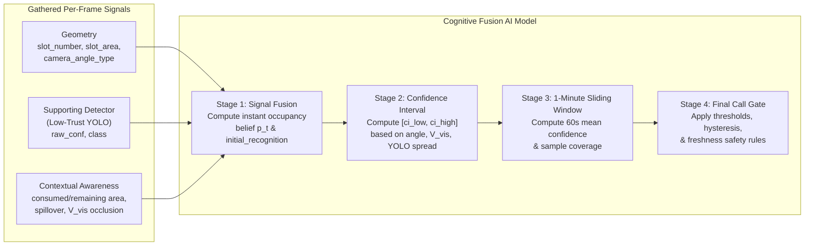

# Module 3 — Cognitive Fusion AI Model

> **Status:** **Target New Module** (planned `src/parking_occupancy/fusion_model.py`, connecting `geometry.py`, `inference.py`, `contextual.py`, `smoothing.py`, and `freshness.py`)  
> **Data Policy:** Trained/calibrated and tested on **dummy time-series data** (`BACKEND_MODE=mock`)

---

## 1. Purpose: The Cognitive Integrator

While Geometry handles perspective reshaping, YOLO proposes low-trust vehicle candidates, and Contextual Awareness models area consumption and neighbor blocking, **Module 3 (the Cognitive Fusion AI Model)** is the central decision brain that connects all gathered data across both **space** and **time**.

Specifically, it interconnects and tracks the exact structured decision chain per slot:
1. **`slot_number`** (plus mapped canonical `space_id` UUID & `lot_code`)
2. **`slot_area`** (calibrated BEV area, plus consumed/remaining area breakdown)
3. **`initial_recognition`** (raw per-frame occupancy classification: `occupied | available | unknown`)
4. **`confidence_interval`** (uncertainty interval `[ci_low, ci_high]` + calibrated point estimate)
5. **`one_minute_mean_confidence`** (60-second sliding window mean of occupancy confidence)
6. **`final_call`** (stabilized decision: `occupied | available | unknown` sent onward to backend events)

---

## 2. Interconnected Slot Decision Data Model

Every slot maintained by `fusion_model.py` produces a structured `CognitiveSlotDecision` object:

```python
@dataclass
class CognitiveSlotDecision:
    # 1. Identity & Geometry
    slot_number: str            # e.g., "A-C01"
    space_id: str               # e.g., "30000000-0000-4000-8000-000000000001"
    lot_code: str               # "A" | "B" | "C" | "D"
    camera_angle_type: str      # "cctv_oblique" | "optimized_angle"
    slot_area: float            # Calibrated BEV polygon area (px² or m²)
    effective_area: float       # Adapted usable area from Module 1B (<= slot_area)
    depth_distortion_j: float   # Local perspective stretch factor J from Module 1B
    consumed_area: float        # Area occupied by overlapping vehicle footprints
    remaining_area: float       # Unoccupied area inside slot

    # 2. Instantaneous Recognition (Frame-level)
    initial_recognition: PhysicalStatus   # occupied | available | unknown
    instant_confidence: float | None      # Calibrated point occupancy belief [0, 1] or None

    # 3. Uncertainty Quantification
    confidence_interval: tuple[float, float] | None  # (ci_low, ci_high) around occupancy belief

    # 4. 1-Minute Temporal Aggregation
    one_minute_mean_confidence: float | None  # Mean belief over last 60.0s window
    samples_in_window: int                    # Number of valid frames in last 60.0s
    window_coverage_ratio: float              # Valid frames / expected frames in 60.0s

    # 5. Final Stabilized Call
    final_call: PhysicalStatus                # occupied | available | unknown
    final_confidence: float | None            # None when final_call == unknown
    decision_reason: str                      # e.g., "1m_mean_occupied", "spillover_blocked", "occluded"
```

---

## 3. How the Signals Are Connected (4-Stage Cognitive Pipeline)



### Stage 1 — Multi-Signal Belief Fusion (`initial_recognition` & $p_t$)

Instead of blindly trusting raw YOLO confidence, the model computes an **instantaneous occupancy belief** $p_t \in [0, 1]$ (where $1.0 =$ definitely occupied, $0.0 =$ definitely available) via weighted evidence fusion:

$$p_t = w_{\text{area}} \cdot S_{\text{area}} + w_{\text{ctx}} \cdot S_{\text{ctx}} + w_{\text{det}} \cdot S_{\text{det}}$$

Where:
- **$S_{\text{area}}$ (Geometric Area Evidence, high weight e.g. $0.45$):** Driven by $\rho_i = A_{\text{consumed}, i} / A_{\text{slot}, i}$ and whether $A_{\text{rem}, i}$ is too small to fit another vehicle.
- **$S_{\text{ctx}}$ (Contextual Relational Evidence, medium-high weight e.g. $0.35$):** Accounts for neighbor spillover (`spillover_blocked` forces high $S_{\text{ctx}}$) and foreground visibility $V_{\text{vis}, i}$.
- **$S_{\text{det}}$ (Supporting Object Detector Evidence, deliberately LOWER weight e.g. $0.20$):** Bounded/discounted raw YOLO score so low detector certainty never hijacks the model, and a momentary missed box does not erase strong geometric/contextual state.

**Camera-Type Adjustment (`cctv_oblique` vs. `optimized_angle`):**
- On `optimized_angle`, $w_{\text{area}}$ is even stronger because ground-plane distortion is tiny.
- On `cctv_oblique`, contextual occlusion ($V_{\text{vis}}$) exerts gating authority: if $V_{\text{vis}, i} < V_{\text{min}}$ (default `0.45`) and no clear vehicle is seen in the remaining visible sliver, the frame produces `initial_recognition = UNKNOWN` (`instant_confidence = None`, excluded from numerical average rather than treated as `0.0` available!).

---

### Stage 2 — Confidence Interval Calculation (`[ci_low, ci_high]`)

A point score alone hides whether the system is guessing under heavy distortion or observing a crystal-clear bay. We compute a calibrated **confidence interval** around $p_t$:

$$\text{CI}_t = \big[\max(0.0, \, p_t - \delta_t), \; \min(1.0, \, p_t + \delta_t)\big]$$

The uncertainty half-width $\delta_t$ widens or narrows dynamically based on four observable factors:
1. **Camera Angle & Depth Stretch Penalty ($\delta_{\text{angle}}(J_i)$):** Larger on `cctv_oblique` (scaled by Module 1B's per-slot Jacobian stretch factor $J_i$ on far rows) than on `optimized_angle`.
2. **Visibility / Occlusion Penalty ($\delta_{\text{vis}}$):** Proportional to $1 - V_{\text{vis}, i}$; heavily occluded slots have wide intervals.
3. **Low-Trust Detector Variance ($\delta_{\text{det}}$):** Wider when YOLO confidence sits in the weak band (`0.20–0.45`) or disagrees with area overlap.
4. **Remaining Area & Adaptive Drift Ambiguity ($\delta_{\text{rem}}$):** Slightly wider when $\rho_i$ sits near a boundary (e.g. partial bumper edge at $15\%\text{–}30\%$) or while an adaptive $\Delta H$ offset is settling.

*Why this matters:* If `[ci_low, ci_high]` straddles the decision boundary (e.g., `[0.35, 0.72]`), the single-frame signal is recognized as **uncertain**, deferring to the **1-minute mean confidence** rather than flipping prematurely!

---

### Stage 3 — 1-Minute Mean Confidence (`one_minute_mean_confidence`)

To achieve stable, cognitive temporal understanding rather than reactive frame-by-frame jitter, each slot maintains a timestamped sliding buffer $\mathcal{W}_{60\text{s}}$ (using `collections.deque` pruned by `frame.timestamp - entry.ts <= 60.0`):

$$\bar{p}_{60\text{s}} = \frac{1}{|\mathcal{W}_{\text{valid}}|} \sum_{(t_k, p_k) \in \mathcal{W}_{\text{valid}}} p_k$$

Where $\mathcal{W}_{\text{valid}}$ contains recent non-`UNKNOWN` frame beliefs within the trailing **60.0 seconds** (`1 minute`).

**Key Properties of the 1-Minute Mean:**
- **Handles Intermittent Detector Dropouts:** If low-trust YOLO drops a vehicle for 2 seconds out of 60, $\bar{p}_{60\text{s}}$ stays smoothly around `0.85+`—no flicker!
- **Distinguishes Passing Cars from Parked Cars:** A car driving through an aisle or momentarily crossing a bay raises $p_t$ for only $3\text{–}5$ seconds, leaving $\bar{p}_{60\text{s}}$ low (`< 0.20`), preventing false occupancy!
- **Explicit Coverage Check (`window_coverage_ratio`):** Tracks how much of the 60-second window actually had valid non-stale observations. If too few valid samples exist (e.g., camera was offline for 45s out of the last 60s, or slot was occluded for most of the minute), the model **refuses** to declare `available` and outputs `UNKNOWN`.
- **Optional Recency Weighting (EMA / Linear Decay):** Can weight the most recent 10–15 seconds slightly higher than 55-second-old frames so genuine arrivals/departures confirm within reasonable latency (e.g., $5\text{–}15\text{s}$ transition while maintaining 60s stability memory).

---

### Stage 4 — Final Call Decision Logic (`final_call`)

The final call combines `one_minute_mean_confidence` ($\bar{p}_{60\text{s}}$), `confidence_interval`, `window_coverage_ratio`, and **Module 2 contextual overrides**:

| Condition | `final_call` | `final_confidence` | Reason |
|---|---|---|---|
| Camera stale (`freshness.py`) OR resolution/calibration mismatch | `unknown` | `null` | Stale/uncalibrated safety guard |
| `window_coverage_ratio < min_coverage` (e.g. `< 0.30` valid samples in 60s) or persistent `occluded_unknown` | `unknown` | `null` | Insufficient visual evidence in 1-min window |
| `spillover_blocked` confirmed across window | `occupied` | $\bar{p}_{60\text{s}}$ | Neighbor vehicle consumes usable area |
| $\bar{p}_{60\text{s}} \ge \theta_{\text{occ}}$ (e.g. `0.60`) **AND** $\text{CI}_{\text{low}} > \theta_{\text{ambig}}$ (e.g. `0.40`) **AND** hysteresis met | `occupied` | $\bar{p}_{60\text{s}}$ | Confirmed occupied over 1-min evidence |
| $\bar{p}_{60\text{s}} \le \theta_{\text{avail}}$ (e.g. `0.25`) **AND** $\text{CI}_{\text{high}} < 0.50$ **AND** hysteresis met | `available` | $1.0 - \bar{p}_{60\text{s}}$ | Confirmed clear & full usable area open |
| Middle band ($0.25 < \bar{p}_{60\text{s}} < 0.60$) or CI straddles ambiguity band | Hold previous confirmed state (or `unknown` at startup) | `null` if `unknown` else previous | Hysteresis prevents oscillation |

*(Note: For `occupancy_observation` payload serialization, `confidence` represents confidence in the reported `physical_status` — i.e., high when clearly occupied OR high when clearly available, and strictly `null` when `unknown`.)*

---

## 4. Evolution Path: Rule-Based Cognitive Fusion → Lightweight Learned Model

This module is designed so it works immediately with **dummy data** using deterministic calibrated weights, and can later upgrade seamlessly to a lightweight ML classifier (e.g., Logistic Regression / Gradient Boosted Tree / Small MLP on tabular slot features) without changing any interfaces:

- **Phase A (Dummy-Data Deterministic Fusion):** Explicit weighted formula + 60s window stats + rule gates. Zero training data needed; completely inspectable and testable in unit tests.
- **Phase B (Calibrated Tabular Model — Optional):** Train a tiny scikit-learn / ONNX classifier on the exact feature vector (`slot_area`, `consumed_area`, `remaining_area`, `visible_area_ratio`, `yolo_raw_conf`, `camera_angle_type`, `one_minute_mean_confidence`, `ci_width`) extracted from synthetic & held-out sessions.

---

## 5. Worked Dummy-Data Example

Suppose **Slot `A-C02`** (`slot_area = 10,000 px²`, `cctv_oblique`):
1. **Frame at $t = 60\text{s}$:** Low-trust YOLO detects a partially occluded car with weak `raw_conf = 0.34`, while Geometry + Contextual Awareness measure `consumed_area = 5,800 px²`, `remaining_area = 4,200 px²` (not enough remaining room for a second car), `visible_area_ratio = 0.85`.
2. **`initial_recognition`:** `occupied` ($p_t = 0.78$).
3. **`confidence_interval`:** `[0.63, 0.93]` (moderately wide because of CCTV oblique angle + low raw YOLO score).
4. **`one_minute_mean_confidence`:** Over the trailing 60s ($t = 0\text{s}..60\text{s}$), 58/60 valid frames averaged $\bar{p}_{60\text{s}} = 0.81$ (`window_coverage_ratio = 0.97`).
5. **`final_call`:** `occupied` with `final_confidence = 0.81` → serialized by `events.py` with `correlation_id: null`.

---

## 6. Area B2 Dual-Model Cross-Check (`YOLOX-L` + `MiDaS-Small` Depth Residual)

For Area B2 ([`parking_ai_check.py`](../scripts/area_b2/parking_ai_check.py) / [`parking_ai_check.csv`](../scripts/area_b2/parking_ai_check.csv)), where only a single `2048×1536` photo is available (not a labeled training dataset), two pretrained networks check each other across all **29 slots**:

1. **Model A — `yolox_l.onnx` (Tiled + Zoomed Crops):** Checks whether a vehicle bounding box falls over the slot anchor (`det ∈ {0, 1}`).
2. **Model B — `midas_small.onnx` (Monocular Relative Depth, `256×256` input):** Estimates relative inverse depth $d(x,y)$. A flat concrete ground plane $d = ax + by + c$ is fitted by least squares on bare-concrete patches (`GROUND_NEAR` and `GROUND_FAR`) after dropping $2.5\sigma$ shadow/stain outliers. Each slot anchor's residual height $z = \bar{r}_{28\times 28} / \sigma$ above concrete is classified as vehicle mass when $z \ge 4.0$.

### Cross-Check Verdict Breakdown (22 / 29 Strong Agreement)

| Zone | Slots | Agreement Summary | Notes |
|---|---|---|---|
| **Left Row** | `L1–L11` | `L1–L10`: **`both`**; `L11`: **`none`** | Zoomed far-end pass found no 11th vehicle; `L11` stays `unconfirmed`. |
| **Right Row** | `R1–R11` | `R1–R2, R4–R8`: **`both`**; `R3, R9–R10`: **`one`**; `R11`: **`none`** | `R9–R10` dark cars stacked behind silver van (`R6`) have weak support ($z=1.8, 0.6$) → marked **`probable`**. |
| **Middle Aisle** | `M1–M7` | `M1–M2, M5–M7`: **`both`**; `M3, M4`: **`one`** | All 7 informal vehicles detected by YOLOX; MiDaS missed `M3` ($z=1.5$) and crosswise `M4` ($z=2.4$). |

### Asymmetric Trust Rule & Training Roadmap
- **Depth is Positive-Only Evidence:** Because `MiDaS-small` is coarse, relative, and shaky past the near half of the lot, a high $z$-score confirms a vehicle (`yes`), while a low $z$-score **must never override** a valid detector box (`M3`, `M4`, `R3`) to falsely report an empty slot.
- **Next Step (Production Fine-Tuning):** Request labeled fixed-camera frames from ICT as the supervised dataset to fine-tune the detector directly on camera coordinates, keeping the one-time homography calibration in [`topview_slots.py`](../scripts/area_b2/topview_slots.py).
