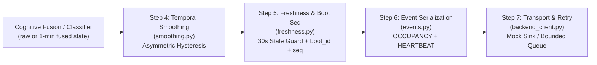

# Pipeline Finale — Temporal Smoothing, Freshness, Stale Recovery & Backend Events

> **Status:** Implemented in [`smoothing.py`](../src/parking_occupancy/smoothing.py), [`freshness.py`](../src/parking_occupancy/freshness.py), [`events.py`](../src/parking_occupancy/events.py), and [`backend_client.py`](../src/parking_occupancy/backend_client.py)  
> **Integration Contract:** `CANDIDATE-2026-10-30.2` (Provisional `schema_version: "1.0.0"`; real transport `BLOCKED` pending auth/TLS/backend implementation)

---

## 1. End-of-Pipeline Lifecycle Steps

Once the Cognitive Fusion AI Model (or current `PolygonMap.classify()` baseline) produces per-frame space assessments, three operational safeguards ensure SENTRY only receives **stable, fresh, strictly ordered observations**:



---

## 2. Step 4 — Temporal Smoothing & Hysteresis (`smoothing.py`)

Even with 1-minute mean confidence, edge-threshold crossings require **asymmetric hysteresis** so states do not flip back and forth around threshold boundaries.

### Implemented Rules in `StateSmoother`
- **Asymmetric Thresholds:**
  - `n_to_occupied` (default `3` consecutive frames via `smoothing_consecutive_frames`)
  - `n_to_available` (default `max(n, n + 2)` = `5` consecutive frames — confirming a space is empty requires *more* evidence than confirming it is occupied)
- **Unknown Interrupt Rule (`_advance`):**
  - If `raw == PhysicalStatus.UNKNOWN`, `pending_status` resets to `UNKNOWN` and `consecutive_count` resets to `0`.
  - **Missing data or unknown frames NEVER count toward `AVAILABLE`!**
- **Per-Space Isolation (`_SpaceBuffer`):**
  - Each `space_id` maintains independent `confirmed_status`, `pending_status`, and `consecutive_count`.
- **Reconnect / Reset (`reset_space`):**
  - Allows clearing per-space buffers after camera reconnection or calibration reload.

---

## 3. Step 5 — Freshness, Staleness, Boot UUID & Sequences (`freshness.py`)

Cameras disconnect, freeze, or get bumped. [`FreshnessTracker`](../src/parking_occupancy/freshness.py) ensures stale or out-of-order observations never masquerade as live parking availability.

### Implemented Rules in `FreshnessTracker`
1. **Boot Identity (`boot_id`):**
   - Generated as a fresh UUIDv4 on startup and regenerated via `reconnect()`.
   - Identifies the continuous lifecycle of a camera session.
2. **Per-Space Monotonic Sequences (`_SpaceTracker`):**
   - Each `space_id` gets an independently incrementing integer `sequence_number` (`1, 2, 3, ...`) within the current `boot_id`.
   - Resets to `0` on `reconnect()`.
3. **Staleness Timeout (`freshness_threshold_s = 30.0` default test config):**
   - Checks `elapsed = now - self._last_frame_time` (using injectable `clock_fn` for deterministic fake-clock tests).
   - If `elapsed > threshold`, `_is_stale` becomes `True` and **all spaces on that camera transition immediately to `PhysicalStatus.UNKNOWN` (`confidence=None`)**.
4. **Strict Fresh-Frame Recovery:**
   - While `_is_stale` is `True`, re-evaluating an old frame with the same timestamp (`frame_timestamp <= _last_seen_frame_timestamp + 0.001`) stays `UNKNOWN`.
   - Only a genuinely newer frame (strictly advancing `frame_timestamp`) clears `_is_stale` and restores live state!
   - **Heartbeats NEVER refresh stale space coverage.**
5. **No Backend Visit / Assignment Side Effects:**
   - Going `UNKNOWN` never causes AI to issue any space-release or visit-closure call. FastAPI owns official visit/assignment reconciliation.

---

## 4. Step 6 — Event Serialization (`events.py`)

[`EventEmitter`](../src/parking_occupancy/events.py) emits events **only on state transitions** (`occupied ↔ available ↔ unknown`) or when `refresh_interval_s` (`300.0s`) elapses, plus periodic `device_heartbeat` events every `heartbeat_interval_s` (`60.0s`).

### `occupancy_observation` Payload (`build_occupancy_event`)
```json
{
  "schema_version": "1.0.0",
  "event_id": "<uuid4>",
  "event_type": "occupancy_observation",
  "occurred_at": "2026-11-17T02:57:00Z",
  "producer_id": "occupancy-lot-a-01",
  "correlation_id": null,
  "data": {
    "lot_code": "A",
    "space_id": "30000000-0000-4000-8000-000000000001",
    "physical_status": "occupied",
    "confidence": 0.81,
    "boot_id": "<uuid4>",
    "sequence_number": 17,
    "calibration_version": "lot-a-example-v1",
    "model_version": "occupancy-demo-1"
  }
}
```

### Mandatory Serialization Rules
- `correlation_id` is **always `null`** (occupancy is independent of gate access attempts).
- `confidence` is **forced to `null`** whenever `physical_status == "unknown"`.
- `occurred_at` is RFC 3339 UTC ending in `Z`.
- Retrying a failed delivery **must preserve** the exact original `event_id`, `occurred_at`, and body (idempotent replay).

*(Note: While internal Cognitive Fusion metrics such as `confidence_interval` and `one_minute_mean_confidence` drive `physical_status` and `confidence`, they are logged locally / in evaluation reports rather than added as unauthorized wire keys unless approved via a SENTRY contract PR!)*

---

## 5. Step 7 — Backend Transport & Bounded Retry (`backend_client.py`)

[`BackendClient`](../src/parking_occupancy/backend_client.py) decouples observation production from transport:

| Mode | Behavior |
|---|---|
| **`BackendMode.MOCK`** (Active Dev Mode) | Logs `[MOCK] OCCUPANCY` and `[MOCK] HEARTBEAT` locally; never sends network traffic or pretends to be live API integration. |
| **`BackendMode.REAL`** (`BLOCKED`) | Posts to `/api/v1/observations/occupancy` & `/api/v1/observations/heartbeat` with Bearer token. Raises `RuntimeError` if `BACKEND_API_BASE_URL` is unconfigured; blocked pending approved backend handlers, device auth, TLS, and SEC-01/SEC-02. |

### Bounded Retry Queue
- `_retry_queue` uses `collections.deque(maxlen=100)` (`MAX_RETRY_QUEUE_SIZE = 100`).
- On transient failure (`httpx.RequestError`, `TimeoutException`, or non-2xx/409 status), payloads enqueue with exponential backoff (`BASE_RETRY_DELAY_S = 2.0`, capped at `MAX_RETRY_DELAY_S = 60.0`).
- On `409 Conflict` (changed content under same `event_id`), drops rather than looping forever.
- On queue saturation (`>= 100`), drops the oldest item with an explicit error log.
- `202` / `200` responses represent **observation receipt only**, never gate or assignment authority.

