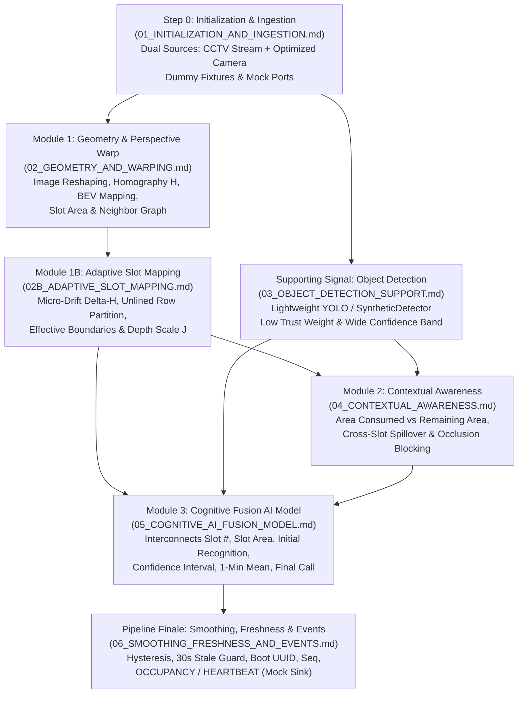

# SENTRY Parking Occupancy — Module & Step Specifications

> **Module Root:** `ai_services/parking_occupancy/`  
> **Scope:** Occupancy AI Team (Lots A, B, C, and D — `car_only` and `motorcycle_only`)  
> **Data Policy:** Dummy / synthetic data only during current mock development (`BACKEND_MODE=mock`)  
> **Backend Authority:** Observations only — never reserves/releases spaces, identifies drivers, or accesses PostgreSQL

---

## Purpose of This Documentation Set

This `docs/` suite breaks down the **SENTRY Parking Occupancy** subsystem into its sequential operational steps and cognitive modules. It bridges the **existing Python foundation** in `src/parking_occupancy/` with the **extended two-source warping, contextual area awareness, and cognitive fusion model architecture**.

### End-to-End Cognitive Pipeline

---

## Document Index

| File | Focus | Status vs. Current Codebase |
|---|---|---|
| [01 — Initialization & Ingestion](01_INITIALIZATION_AND_INGESTION.md) | Config bootstrap, `boot_id`, dual source ingestion (CCTV vs. optimized camera), dummy data loading | Foundation in [`__main__.py`](../src/parking_occupancy/__main__.py) & [`capture.py`](../src/parking_occupancy/capture.py); dual-profile configs planned |
| [02 — Geometry & Perspective Warping](02_GEOMETRY_AND_WARPING.md) | Image reshaping, homography estimation ($H$), BEV warping (`warpPerspective`) & coordinate projection (`perspectiveTransform`) for CCTV vs. optimized views | Foundation in [`geometry.py`](../src/parking_occupancy/geometry.py) & [`mark_polygons.py`](../scripts/mark_polygons.py); ground-footprint & dual-profile calibration planned |
| [02B — Adaptive Mapping of Slots](02B_ADAPTIVE_SLOT_MAPPING.md) | Micro-drift homography alignment ($\Delta H$), row-corridor auto-partitioning, effective boundary adaptation ($P_{\text{eff}}$), perspective-depth scaling | **Target new module** (`adaptive_mapping.py` planned) |
| [03 — Supporting Object Detection](03_OBJECT_DETECTION_SUPPORT.md) | Lightweight vehicle candidate detection (YOLOv8n / `SyntheticDetector`), deliberately lower confidence weighting | Foundation in [`inference.py`](../src/parking_occupancy/inference.py); confidence-interval calibration & soft weighting planned |
| [04 — Contextual Awareness](04_CONTEXTUAL_AWARENESS.md) | Slot fill recognition, vehicle area consumption, remaining free area, cross-slot spillover, neighbor occlusion/blocking (dummy data first) | **Target new module** (`contextual.py` planned) |
| [05 — Cognitive Fusion AI Model](05_COGNITIVE_AI_FUSION_MODEL.md) | Cognitive hub combining `slot_number`, `slot_area`, `initial_recognition`, `confidence_interval`, `1-minute mean confidence`, and `final_call` | **Target new module** (`fusion_model.py` planned) |
| [06 — Smoothing, Freshness & Events](06_SMOOTHING_FRESHNESS_AND_EVENTS.md) | Hysteresis smoothing, stale/disconnect recovery, boot/sequence monotonicity, `CANDIDATE-2026-10-30.2` mock transport | Foundation in [`smoothing.py`](../src/parking_occupancy/smoothing.py), [`freshness.py`](../src/parking_occupancy/freshness.py), [`events.py`](../src/parking_occupancy/events.py), [`backend_client.py`](../src/parking_occupancy/backend_client.py) |
| [07 — Development Roadmap & Dummy Data](07_END_TO_END_DEVELOPMENT_ROADMAP.md) | Step-by-step implementation schedule, dummy data design, testing strategy, SENTRY gates | Master execution plan aligning SENTRY Phases 1–10 |
| [Backend Team Q&A (`B1–B5` / `B2, B3, B4`)](BACKEND_TEAM_QA_B1_B5.md) | Campus scope (`B1–B5`, active `B2, B3, B4`), 69-slot mapping, device IDs, CSV-driven `POST` contract, two-tier monitor cadence, & test commands | Answers backend integration questions (points to [`sample_b2_b4_messages.json`](sample_b2_b4_messages.json)) |
| [Area B3 Layout & Monitoring Guide](LOT_B3_KNOWLEDGE.md) | Provisional 20-bay Lot `B3` calibration (`L1–L9`, `R1–R10` PWD, `C1`), informal aisle zones, homography, & change-monitor behavior | Active in 3-lot 4-model pipeline; ref [`change_monitor.py`](../scripts/lot_b3/change_monitor.py) |
| [Sample B2 & B4 JSON Messages](sample_b2_b4_messages.json) | `CANDIDATE-2026-10-30.2` HTTP `POST` fixture (`occupancy_observation` & `device_heartbeat` derived from 4-model CSV) | Verified test fixture for backend ingestion |
| [Vercel & Mobile Remote Capture Guide](VERCEL_MOBILE_DEPLOYMENT.md) | Zero-build static deployment on Vercel, mobile rear-camera capture, HTTPS tunnel pairing, & PC `/api/upload` receiver | Production guide for away-from-PC photo uploads |

---

## Core Architectural Principles

1. **Two Distinct Camera Data Types:**
   - **Data Type A — Campus CCTV Stream / Image:** High-mount, oblique, heavily foreshortened views (similar to BSU Views A, B, and C). Requires strong homography warping, occlusion reasoning, and wider confidence intervals.
   - **Data Type B — Optimized-Angle Camera:** Dedicated or near-overhead test/monitoring angle with minimal occlusion and clean rectangular geometry. Used as high-clarity calibration/validation data and dedicated bay feeds.
2. **Object Detection Is Supporting, Not Authoritative:**
   - YOLO (or `SyntheticDetector`) is treated as a **low-weight, lower-confidence proposal generator** that finds candidate vehicles in raw frames. It is **not** the primary decision maker because oblique angles, partial occlusions, and shadows degrade raw detector scores.
3. **Contextual Intelligence Precedes Final Decisions:**
   - A vehicle parked in Slot $A$ can spill over into Slot $B$ or visually block Slot $C$ along the camera sightline. Measuring **consumed area vs. remaining free area** prevents falsely reporting blocked or partially encroached slots as `available`.
4. **1-Minute Confidence Averaging & Uncertainty:**
   - Instantaneous per-frame occupancy includes an explicit **confidence interval** (`[ci_low, ci_high]`).
   - A **1-minute rolling mean confidence** aggregates evidence across frames while guarding against stale/dropped frames before producing the **final call** (`occupied | available | unknown`).
5. **100% Dummy / Synthetic Data First:**
   - All development, unit tests, contextual overlap simulations, and 1-minute time-series tests run on synthetic frames, dummy polygons, and `BACKEND_MODE=mock`. No live campus streams, real license plates, or real participant data are committed or required.
6. **Strict SENTRY System Invariants:**
   - `correlation_id` is always `null` on `occupancy_observation` and `device_heartbeat` events.
   - Space compatibility is strictly `car_only | motorcycle_only` (never `mixed`).
   - `unknown` (`confidence: null`) on stale/occluded/uncalibrated coverage **never** collapses to `available` and **never** releases backend visits or assignments.
